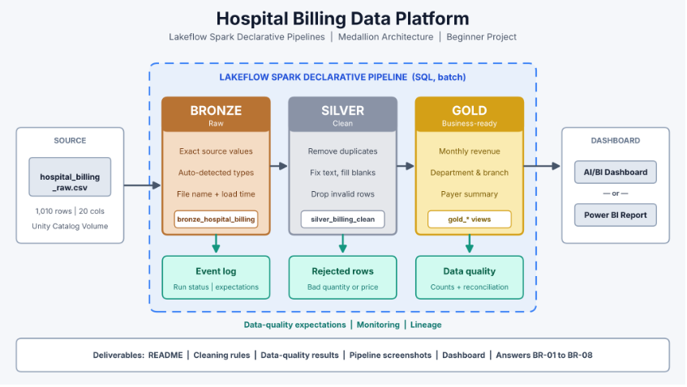
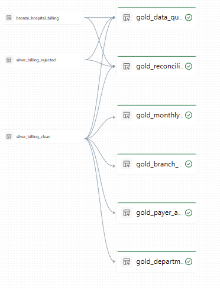
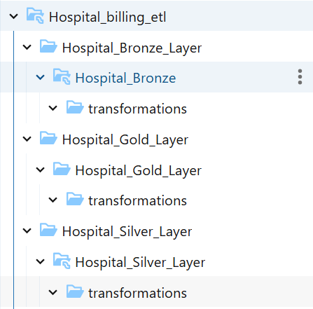
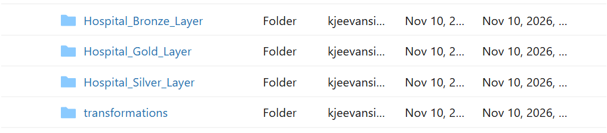

# Hospital Billing Analytics | Medallion Architecture

An end-to-end **hospital billing data engineering project** built with **Azure Databricks**, **Lakeflow Spark Declarative Pipelines (SQL)**, and the **Medallion Architecture (Bronze → Silver → Gold)**.

The pipeline ingests raw hospital billing records, standardizes patient, visit, service, branch, and payer attributes, applies billing data-quality rules, and creates Gold-level business views for revenue, department, branch, payer, and data-quality analysis.



---

## Table of Contents

- [Business Problem](#business-problem)
- [Project Objectives](#project-objectives)
- [Architecture](#architecture)
- [Technology Stack](#technology-stack)
- [Dataset](#dataset)
- [Repository Structure](#repository-structure)
- [Medallion Layers](#medallion-layers)
- [Gold Analytics Views](#gold-analytics-views)
- [Data Quality Rules](#data-quality-rules)
- [Reconciliation](#reconciliation)
- [How to Run](#how-to-run)
- [Business Requirements Coverage](#business-requirements-coverage)
- [Key Business Questions](#key-business-questions)
- [Documentation and Resources](#documentation-and-resources)
- [Future Enhancements](#future-enhancements)

## Business Problem

Hospital billing systems generate records across patients, visits, departments, doctors, services, hospital branches, payer types, and payment statuses. Inconsistent text, missing values, duplicate records, and invalid quantities or prices can reduce the reliability of financial and operational reporting.

This project demonstrates a repeatable data pipeline that preserves source records, standardizes and validates billing data, and publishes curated analytical views for hospital management and reporting.

## Project Objectives

- Ingest raw hospital billing CSV data into a traceable Bronze layer.
- Add source-file and ingestion-time metadata.
- Standardize descriptive fields and handle selected missing values in Silver.
- Separate records with invalid quantities or unit prices into a rejected view.
- Derive total billing amounts when the source amount is missing.
- Build Gold views for monthly revenue, department performance, branch performance, payer analysis, and data-quality monitoring.
- Provide a high-level reconciliation summary across Bronze and Silver.

## Architecture

The project follows the Medallion Architecture:

```text
hospital_billing_raw.csv
          |
          v
     BRONZE LAYER
 Raw ingestion + metadata
          |
          v
     SILVER LAYER
 Standardization + validation
       /       \
      v         v
 Clean billing  Rejected billing
       |
       v
      GOLD LAYER
 Revenue + operational aggregates
 + data quality + reconciliation
       |
       v
 Databricks SQL / BI dashboards
```

### Architecture Diagram


### Pipeline Diagram



### Workspace Structure





## Technology Stack

| Technology | Usage |
|---|---|
| Azure Databricks | Data engineering and pipeline environment |
| Lakeflow Spark Declarative Pipelines | Declarative SQL pipeline processing |
| Apache Spark SQL | Ingestion, transformation, and aggregation |
| Unity Catalog Volumes | Source CSV storage |
| Delta Lake | Managed table storage in Databricks |
| CSV | Raw hospital billing dataset |
| Git and GitHub | Version control and documentation |

## Dataset

- **File:** `data/hospital_billing_raw.csv`
- **Format:** CSV
- **Purpose:** Raw hospital billing and visit-level service records.
- **Configured ingestion path:** `/Volumes/hospital_billing/default/hospital_sales`

The SQL references fields including:

- Identifiers: `bill_id`, `visit_id`, `patient_id`
- Patient and visit details: `patient_gender`, `patient_age`, `visit_date`, `visit_type`
- Hospital details: `department`, `doctor_name`, `hospital_branch`, `city`, `region`
- Service details: `service_category`, `service_name`, `quantity`, `unit_price`
- Billing and payment: `total_amount`, `insurance_amount`, `payer_type`, `payment_status`

The source file is included in the repository. Upload it to the configured Databricks Volume before running the pipeline. The SQL scripts target catalog `hospital_billing` and schema `default`.

## Repository Structure

```text
Hospital_Billing_Analytics/
│
├── Hospital_Bronze/
│   ├── Bronze_transformation.sql
│   └── readme.md
│
├── Hospital_Silver/
│   ├── Silver_transformation.sql
│   └── readme.md
│
├── Hospital_Gold/
│   ├── Gold_transformation.sql
│   └── readme.md
│
├── data/
│   └── hospital_billing_raw.csv
│
├── Images/
│   ├── Hospital_Billing_Architeture.png
│   ├── Hospital_pipeline.png
│   ├── work_structure.png
│   └── work_top_level.png
│
├── docs/
│   ├── Hospital_Billing_Case_Study.pdf
│   ├── data_quality_rules.md
│   ├── reconciliation.md
│   └── review_questions.md
│
└── README.md
```

## Medallion Layers

### 1. Bronze Layer — Raw Ingestion

**Script:** [Bronze_transformation.sql](Hospital_Bronze/Bronze_transformation.sql)

Creates or refreshes the streaming table:

`hospital_billing.default.bronze_hospital_billing`

Key operations:

- Reads CSV files from the configured Unity Catalog Volume using `read_files()`.
- Uses streaming ingestion.
- Retains the source columns.
- Adds `file_path` using Databricks file metadata.
- Adds `ingested_at` using `current_timestamp()`.
- Defines expectations requiring `bill_id`, `visit_id`, and `patient_id` to be non-null.

**Purpose:** preserve the ingested source data and provide basic traceability for downstream processing.

### 2. Silver Layer — Cleaning and Validation

**Script:** [Silver_transformation.sql](Hospital_Silver/Silver_transformation.sql)

Creates two materialized views:

| View | Purpose |
|---|---|
| `silver_billing_clean` | Distinct, standardized billing records that pass quantity and unit-price expectations |
| `silver_billing_rejected` | Records with null/invalid quantity or null/negative unit price, including a rejection reason |

Key operations:

- Uses `SELECT DISTINCT` to remove identical output rows.
- Trims whitespace and standardizes selected text fields with `TRIM()` and `INITCAP()`.
- Replaces selected missing descriptive values with `Unknown`.
- Derives `total_amount` as `quantity * unit_price` when the source total is null.
- Replaces missing `insurance_amount` with zero.
- Requires `quantity > 0` and `unit_price >= 0` in the clean view.
- Creates a `reject_reason` for invalid quantity or unit price in the rejected view.

**Purpose:** create consistent billing records for analysis while retaining visibility into records that fail key billing checks.

### 3. Gold Layer — Business-Ready Analytics

**Script:** [Gold_transformation.sql](Hospital_Gold/Gold_transformation.sql)

Creates six materialized views:

| Gold view | Business purpose |
|---|---|
| `gold_monthly_billing` | Monthly total revenue, insurance amount, and distinct visits |
| `gold_department_performance` | Revenue, visits, and average revenue per visit by department |
| `gold_branch_performance` | Revenue and visits by region, city, and hospital branch |
| `gold_payer_analysis` | Revenue, insurance amount, and pending amount by payer type |
| `gold_data_quality` | Counts of duplicate/residual rows, invalid quantities, invalid prices, and blank departments |
| `gold_reconciliation` | Bronze, clean, rejected, residual counts, and a reconciliation indicator |

**Purpose:** provide curated metrics for financial reporting, hospital operations, and data-quality monitoring.

## Gold Analytics Views

### Monthly Billing
Track monthly revenue, insurance amounts, and distinct visits to understand billing trends over time.

### Department Performance
Compare departments using total revenue, visit volume, and average revenue per visit.

### Hospital Branch Performance
Analyze billing revenue and visit counts across regions, cities, and hospital branches.

### Payer Analysis
Compare payer categories by revenue and insurance amount, and monitor amounts associated with records whose payment status is `Pending`.

### Data Quality Monitoring
Monitor invalid quantities, invalid unit prices, blank departments, and the residual count currently labelled as duplicate rows.

## Data Quality Rules

| Rule | Current SQL behavior |
|---|---|
| Required identifiers | Bronze expectations require bill, visit, and patient IDs to be non-null |
| Duplicate output rows | Silver applies `SELECT DISTINCT` |
| Quantity | Clean view requires quantity greater than zero |
| Unit price | Clean view requires unit price greater than or equal to zero |
| Rejected quantity | Null, zero, or negative quantity is rejected |
| Rejected unit price | Null or negative unit price is rejected |
| Text standardization | Selected fields are trimmed and title-cased |
| Missing descriptions | Selected null text fields become `Unknown` |
| Total amount | Missing total is derived from quantity multiplied by unit price |
| Insurance amount | Missing insurance amount becomes zero |

See [Data Quality Rules](docs/data_quality_rules.md) for detailed implementation notes and limitations.

## Reconciliation

The Gold layer creates `gold_reconciliation` with:

- `bronze_rows`: total Bronze records.
- `clean_rows`: records in the Silver clean view.
- `rejected_rows`: records in the Silver rejected view.
- `duplicates_removed`: Bronze count minus clean count minus rejected count.
- `reconciliation_ok`: checks whether clean plus rejected counts do not exceed Bronze count.

**Important:** the current SQL's `duplicates_removed` is a residual count, not a verified count of duplicate source records. The clean view uses `DISTINCT`, while the rejected view reads directly from Bronze. A record-level reconciliation should define the billing record grain and classify each source row into mutually exclusive accepted, rejected, and duplicate categories.

See [Reconciliation Notes](docs/reconciliation.md).

## How to Run

1. **Prepare the source data.** Upload `hospital_billing_raw.csv` to the Databricks Unity Catalog Volume at `/Volumes/hospital_billing/default/hospital_sales`.
2. **Check the environment.** Confirm that catalog `hospital_billing`, schema `default`, the Volume, and the required permissions exist.
3. **Connect the repository.** Clone or connect this GitHub repository to your Databricks workspace.
4. **Create the pipeline.** Create a Lakeflow Spark Declarative Pipeline and add the SQL scripts from the three layer folders.
5. **Run in dependency order.** Process Bronze, then Silver, then Gold.
6. **Validate Silver.** Inspect `silver_billing_clean` and `silver_billing_rejected`.
7. **Review Gold.** Query the six Gold views and validate their totals against the Silver data.
8. **Check reconciliation.** Review `gold_data_quality` and `gold_reconciliation`; investigate unexpected counts.

The scripts currently use the catalog and schema `hospital_billing.default`. Update the SQL object names and Volume path if your Databricks workspace uses different names.

## Business Requirements Coverage

| ID | Requirement | Gold output |
|---|---|---|
| BR-01 | Monthly billing and revenue analysis | `gold_monthly_billing` |
| BR-02 | Department performance | `gold_department_performance` |
| BR-03 | Hospital branch and location performance | `gold_branch_performance` |
| BR-04 | Payer and pending-payment analysis | `gold_payer_analysis` |
| BR-05 | Data-quality visibility | `gold_data_quality` |
| BR-06 | Layer-level count reconciliation | `gold_reconciliation` |

## Key Business Questions

- How does hospital billing revenue change month over month?
- Which departments generate the highest billing revenue?
- What is the average revenue per visit for each department?
- Which hospital branches and cities have the highest visit volume?
- How does revenue vary by payer type?
- What amount is associated with pending payments for each payer?
- How many billing records contain invalid quantities or unit prices?
- How many records are present in Bronze, clean Silver, and rejected Silver?

## Documentation and Resources

- [Hospital Billing Case Study (PDF)](docs/Hospital_Billing_Case_Study.pdf)
- [Bronze SQL](Hospital_Bronze/Bronze_transformation.sql)
- [Silver SQL](Hospital_Silver/Silver_transformation.sql)
- [Gold SQL](Hospital_Gold/Gold_transformation.sql)
- [Architecture Diagram](Images/Hospital_Billing_Architeture.png)
- [Pipeline Diagram](Images/Hospital_pipeline.png)
- [Data Quality Rules](docs/data_quality_rules.md)
- [Reconciliation Notes](docs/reconciliation.md)
- [Review Questions](docs/review_questions.md)

## Future Enhancements

- Add explicit validation for patient age, visit date, insurance amount, and payment status.
- Define a reliable billing-record key and improve duplicate detection.
- Build mutually exclusive reconciliation categories and compare financial totals across layers.
- Add automated SQL tests for the Silver and Gold views.
- Add pipeline monitoring, failure alerts, and source-file arrival tracking.
- Build a Databricks SQL or Power BI dashboard using the Gold views.
- Parameterize catalog, schema, and Volume paths for deployment to other environments.

---

## Author

**Jeevan Kanumalaputi**

- GitHub: [Jeevan0510](https://github.com/Jeevan0510)
- Project: [Hospital_Billing_Analytics](https://github.com/Jeevan0510/Hospital_Billing_Analytics)
